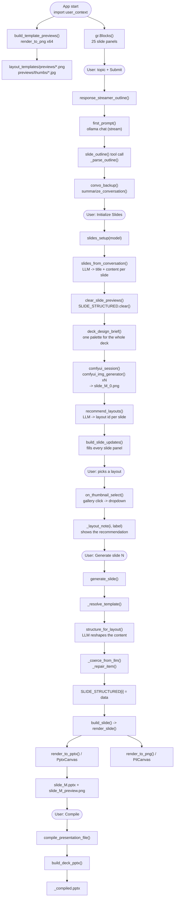

# Code flow — AI Presentation Studio

Which function runs when, and what it does.
Rendered image: **`code_flow.png`** (regenerate with `python generate_code_flow_diagram.py`).

```
user_context.py   the Gradio app: UI, event wiring, orchestration
gemini_code_fixed.py  path helpers, UI updaters, session save/load, per-slide generation, compile
layout_catalogue.py   the 64 templates + the content shape ("kind") of each one
layout_engine.py      the two drawing backends (PPTX + PNG) and the renderer per kind
layout_templates.py   the bridge: template previews, LLM planner, content structuring
imp_functions.py      LLM helpers for the outline and the slide text
def_prompts.py        every prompt (outline, design brief, layout planner, content structurer)
comfyui.py            the ComfyUI client for the slide backdrops
```

---

## 1. The master flow



---

## 2. Stage by stage

### Stage 0 — App start (module import)

| Function | File | What it does |
| --- | --- | --- |
| `build_template_previews()` | `layout_templates.py` | Renders all 64 templates to PNG once and caches them on disk. |
| `render_to_png()` | `layout_engine.py` | Draws one template with the raster backend. |
| `PilCanvas` | `layout_engine.py` | The raster backend (Pillow). |
| `gr.Blocks(...)` | `user_context.py` | Builds the UI: 25 slide panels, each with its own gallery, dropdown, image box and buttons. |

### Stage 1 — Topic → outline

| Function | File | What it does |
| --- | --- | --- |
| `submit_lock()` / `submit_unlock()` | `user_context.py` | Disable / re-enable the buttons while the LLM streams. |
| `response_streamer_outline()` | `user_context.py` | The whole outline stage: streams the reply into the chat box and runs the tool call. |
| `first_prompt()` | `imp_functions.py` | Builds the system + user message list (adds the slide count). |
| `ollama.chat.completions.create()` | — | The actual streaming LLM call, with the outline tool attached. |
| `slide_outline()` | `imp_functions.py` | The tool implementation that writes the outline. |
| `_parse_outline()` | `user_context.py` | `"1. Title"` lines → `{1: "Title"}`. |
| `convo_backup()` | `imp_functions.py` | Writes the transcript to `slide_outline_summary.txt`. |
| `summarize_conversation()` | `imp_functions.py` | One LLM call that keeps the objective of the deck in focus. |

### Stage 2 — Initialize Slides

| Function | File | What it does |
| --- | --- | --- |
| `slides_setup(model)` | `user_context.py` | The orchestrator of this stage. |
| `slides_from_conversation()` | `imp_functions.py` | One LLM call → `[{title, content}, ...]`. |
| `clear_slide_previews()` | `gemini_code_fixed.py` | Deletes the screenshots of the previous deck. |
| `SLIDE_STRUCTURED.clear()` | `gemini_code_fixed.py` | Deletes the structured content of the previous deck. |
| `deck_design_brief()` | `comfyui.py` | ONE palette + shape brief so every slide of the deck matches. |
| `design_brief()` | `comfyui.py` | Asks the LLM for background, accent, shapes, style, mood. |
| `_parse_brief()` | `comfyui.py` | Keeps only the valid fields, forces a safe placement. |
| `comfyui_session(model)` | `comfyui.py` | Context manager: starts ComfyUI once for the whole deck, stops it after (frees the VRAM). |
| `comfyui_img_generator()` | `comfyui.py` | One text-free 16:9 backdrop per slide. |
| `comfyui_prompts()` | `def_prompts.py` | Turns the design brief into the image prompt. |
| `generate()` | `comfyui.py` | `queue_prompt` → `wait_for_result` → `download_image`. |
| `recommend_layouts()` | `layout_templates.py` | One LLM call → a layout id + reason for every slide. |
| `layout_recommend_prompt()` | `def_prompts.py` | Puts the catalogue + the deck into a prompt. |
| `default_layout_for()` | `layout_templates.py` | Heuristic fallback when the model is unavailable. |
| `build_slide_updates()` | `gemini_code_fixed.py` | Fills every slide panel: title, content, layout dropdown, image box, feedback. |

### Stage 3 — Choosing the layout (no LLM)

| Function | File | What it does |
| --- | --- | --- |
| `on_thumbnail_select(evt)` | `gemini_code_fixed.py` | Gallery index → layout label. Each slide has its own gallery, so a click only affects that slide. |
| `make_layout_note_handler(i)` | `user_context.py` | Binds the note to slide *i*. |
| `_layout_note(i, label)` | `user_context.py` | Shows the LLM recommendation and what the template is for. |

### Stage 4 — Generate a slide (the core loop)

| Function | File | What it does |
| --- | --- | --- |
| `make_generate_slide_handler(i)` | `user_context.py` | Binds the button to slide *i*. |
| `generate_slide()` | `gemini_code_fixed.py` | Orchestrates the whole stage. |
| `_resolve_template()` | `gemini_code_fixed.py` | Label / id / name → `Template`; falls back to `default_layout_for()`. |
| `structure_for_layout()` | `layout_templates.py` | Asks the LLM to reshape the content into the template's shape. |
| `layout_content_prompt()` | `def_prompts.py` | The template + its field list, as a prompt. |
| `_coerce_from_llm()` | `layout_templates.py` | Validates the JSON against the field list of the kind. |
| `_repair_item()` | `layout_templates.py` | Fills fields the model named differently (so a slot is never empty). |
| `coerce_content()` | `layout_templates.py` | No-LLM fallback: fits the raw text into the template shape. |
| `SLIDE_STRUCTURED[i] = data` | `gemini_code_fixed.py` | Remembers the finished content (reused by Compile). |
| `build_slide()` | `gemini_code_fixed.py` | Renders the slide and writes both files. |
| `render_slide()` | `layout_templates.py` | Calls both backends with the same data. |
| `render_to_pptx()` / `PptxCanvas` | `layout_engine.py` | Native, editable PowerPoint shapes. |
| `render_to_png()` / `PilCanvas` | `layout_engine.py` | The screenshot of the very same slide. |
| `render_template()` | `layout_engine.py` | Draws the chrome (header, rule) then the kind renderer. |
| `KIND_RENDERERS[kind]` | `layout_engine.py` | The drawing routine for that template. |

Outputs: `generated_presentations/pptN/slides/slide_M.pptx` and
`slide_previews/slide_M_preview.png`.

### Stage 4b — The other two buttons of a slide

| Function | File | What it does |
| --- | --- | --- |
| `make_refresh_handler(i)` | `user_context.py` | Binds "Update slide content" to slide *i*. |
| `regenerate_single_slide()` | `user_context.py` | LLM rewrites title + bullets from the feedback box. |
| `make_image_handler(i)` | `user_context.py` | Binds "Generate image" to slide *i*. |
| `comfyui_img_generator()` | `comfyui.py` | Makes a new backdrop for that slide. |
| `build_slide()` | `gemini_code_fixed.py` | Re-renders the slide on the new backdrop (if it was already structured). |

### Stage 5 — Compile the deck

| Function | File | What it does |
| --- | --- | --- |
| `_generate_all_slides()` | `user_context.py` | Loops over every slide, re-structures it with the LLM, renders it, then compiles. |
| `compile_presentation_file()` | `gemini_code_fixed.py` | Reads title / content / layout / feedback per slide; reuses `SLIDE_STRUCTURED` when the layout has not changed. |
| `build_deck_pptx()` | `layout_engine.py` | One `Presentation`, one slide per entry, each with its own background. |

Output: `generated_presentations/<session>_compiled.pptx` + the download button.

### Stage 6 — Sessions

| Function | File | What it does |
| --- | --- | --- |
| `save_user_session()` | `gemini_code_fixed.py` | Packs the 4 state fields of every slide into `presentation_sessions/<name>.json`. |
| `load_user_session()` | `gemini_code_fixed.py` | Rebuilds every panel and normalises the stored layout to a valid label. |

---

## 3. The state that travels through the pipeline

| Name | Where | What it holds |
| --- | --- | --- |
| `global_prompt` | `user_context.py` | The whole conversation, replayed to the LLM. |
| `deck_outline` | `user_context.py` | `{number: title}` of the agreed outline. |
| `deck_brief` | `user_context.py` | The shared palette / shape brief of the deck. |
| `layout_recommendations` | `user_context.py` | `{slide number: {layout_id, reason}}` from the planner. |
| `SLIDE_STRUCTURED` | `gemini_code_fixed.py` | `{index: structured content}` — the content in the shape of its template. |
| `SLIDE_TEMPLATES` | `gemini_code_fixed.py` | `{index: template id}` — which template the content was written for. |

## 4. Files on disk

| Path | Written by | What it is |
| --- | --- | --- |
| `layout_templates/previews/*.png` | `build_template_previews()` | One full size preview per template. |
| `layout_templates/previews/thumbs/*.jpg` | `build_template_previews()` | The small thumbnails used by the per-slide galleries. |
| `layout_templates/presentation_layout_templates.pptx` | `build_template_deck()` | The specimen deck (64 editable slides). |
| `generated_presentations/pptN/slide_M_0.png` | `comfyui_img_generator()` | The ComfyUI backdrop of slide M. |
| `generated_presentations/pptN/slides/slide_M.pptx` | `build_slide()` | One finished slide, editable in PowerPoint. |
| `slide_previews/slide_M_preview.png` | `build_slide()` | The screenshot of that slide (shown in the UI). |
| `generated_presentations/<session>_compiled.pptx` | `build_deck_pptx()` | The whole deck. |
| `presentation_sessions/<session>.json` | `save_user_session()` | The saved workspace state. |
| `slide_outline_summary.txt` | `convo_backup()` | The conversation transcript. |
