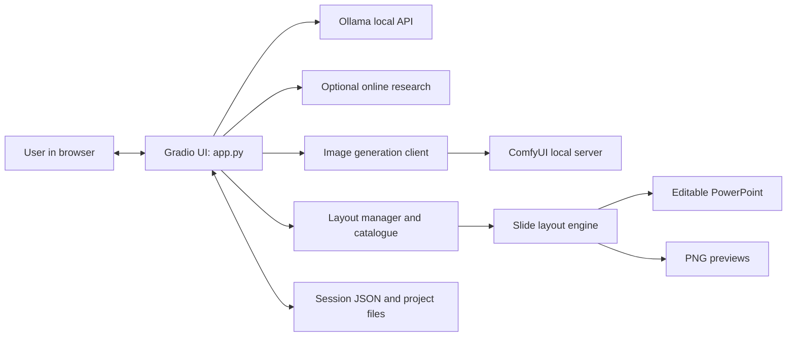

# AI Presentation Studio — Documentation Pack

This pack documents the public `prayush-gupta/deckmaker` repository as inspected on 22 October 2026. It is intended to be copied into the repository root (or merged into an existing `docs/` directory).

## Reading order

1. [Product rationale](docs/01-product-rationale.md) — why a local presentation maker is useful and what trade-offs it introduces.
2. [Architecture](docs/02-architecture.md) — component map, data boundaries, and system diagrams.
3. [End-to-end workflows](docs/03-workflows.md) — setup, deck creation, layout/image generation, save/resume, and export.
4. [Codebase reference](docs/04-codebase-reference.md) — responsibilities and relationships of the main files.
5. [Operations and safeguards](docs/05-operations-safeguards.md) — configuration, troubleshooting, recovery behavior, limitations, and suggested tests.
6. [Glossary](docs/06-glossary.md) — common terms.

## Scope and accuracy

The pack is based on the publicly accessible repository files and its in-repository `README.md`, `DESIGN_REVIEW.md`, and `MERGE_NOTES.md`. It describes observed responsibilities and documented behavior, not a guarantee that every runtime branch has been exercised. In particular, live generation against a local Ollama/ComfyUI installation was not performed during this documentation pass.

The public repository's README is the primary quick-start reference. This pack is a deeper architectural companion; update both when runtime behavior or configuration changes.

## Main system at a glance

## Repository entry points

- `start_windows.bat` → `scripts/start_windows.ps1` → `setup_environment.py` on Windows.
- `start.sh` → `setup_environment.py` on macOS/Linux.
- `app.py` starts the Gradio application after setup.
