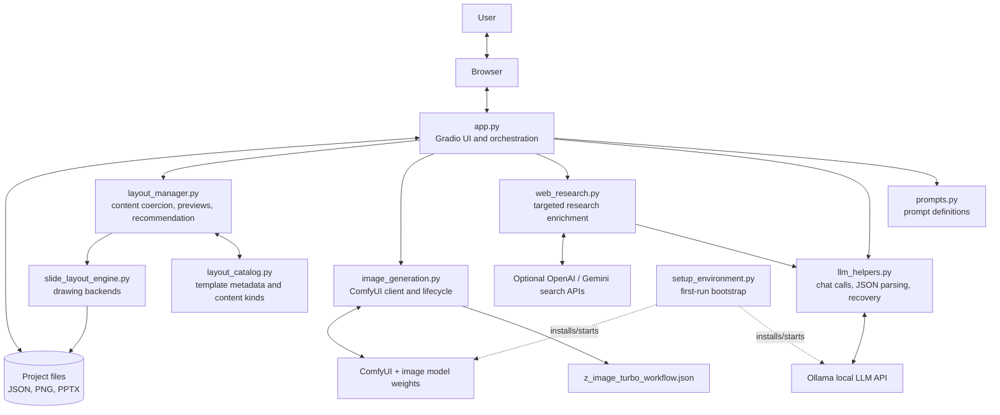
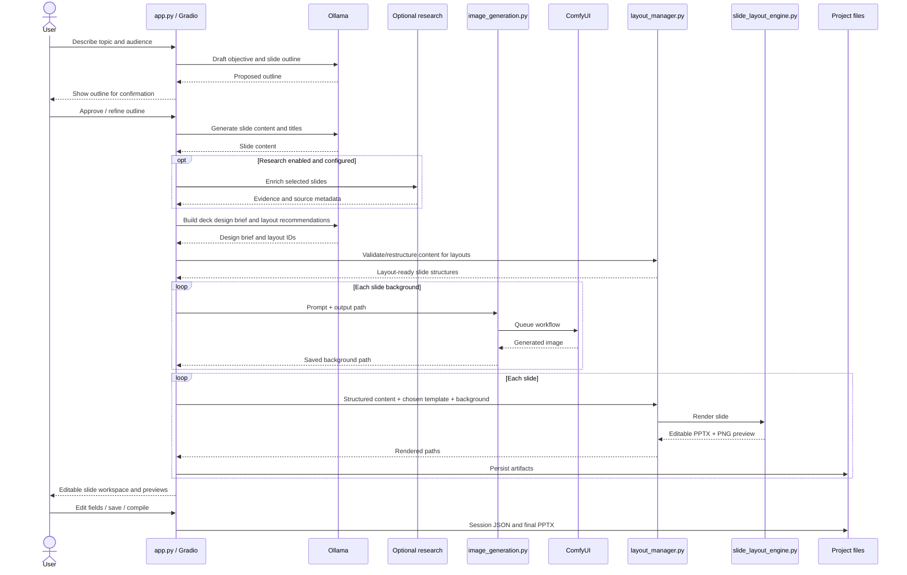

# 2. Architecture and data flow

## 2.1 System boundaries

AI Presentation Studio is a local desktop-style web application: the Python process hosts a Gradio interface, which the user opens in a browser. The browser is the UI surface; the local Python process orchestrates calls to local model services, the layout system, filesystem persistence, and PowerPoint compilation.

The primary local services are:

- **Ollama** at its OpenAI-compatible API endpoint, normally `http://localhost:11434/v1`;
- **ComfyUI** at `http://127.0.0.1:8188`, used for image generation;
- the app's own Python modules for planning orchestration, layout selection, rendering, and persistence.

Optional online research can use configured OpenAI and/or Gemini APIs. It is therefore more accurate to call the project **local-first** than to promise that it is always offline.

## 2.2 Component diagram

## 2.3 Responsibilities and direction of dependencies

### UI and orchestration: `app.py`

`app.py` loads `.env`, initializes the OpenAI-compatible client for Ollama, discovers locally installed models through Ollama's `/api/tags` endpoint, imports the other application modules, and defines the Gradio UI and event handlers. It owns the high-level user journey and coordinates outline, content, layout, artwork, save/resume, and export actions.

The app has global state for items such as the outline, conversation/prompt history, slide titles/content, design brief, layout recommendations, and whether the deck has been initialized. This makes the application stateful within the running process; the session checkpoint is the mechanism for persisting key state across runs.

### Text generation: `prompts.py` and `llm_helpers.py`

`prompts.py` defines role/task instructions for the model. `llm_helpers.py` wraps Ollama chat completion, parses JSON-like model output, maintains/summarizes conversation context, and provides helper functions used by the UI and rendering orchestration.

`robust_chat_completion()` attempts compatible request variants and retries when the model returns no usable final content. It avoids exposing separate model reasoning as user-facing output. Higher-level flows can add their own retries and per-slide recovery.

### Research: `web_research.py`

Research is optional. The local model helps choose a small number of research questions, then configured online providers can search for evidence. Results are used to enrich slides and can be represented as source footers. If no API keys are configured, this capability is limited or unavailable; core local generation does not imply online research is active.

### Artwork: `image_generation.py` and ComfyUI workflow

`image_generation.py` loads the API-format ComfyUI workflow, substitutes prompt/seed/resolution settings, queues work, waits for completion, and retrieves the output image. It can manage a ComfyUI server lifecycle around a batch so the process can be shut down after artwork generation to release GPU memory.

The workflow JSON is not a general Python program; it is a graph of ComfyUI nodes. Node identifiers referenced in the Python client must match the exported workflow. Changing the workflow can therefore require corresponding code changes.

### Layout selection and content structure: `layout_catalog.py` and `layout_manager.py`

`layout_catalog.py` is the template metadata source of truth. Each `Template` includes a stable ID, name, family, content kind, best-use guidance, content pattern, and implementation metadata. The repository documents 68 layouts, including L65–L68 additions.

`layout_manager.py` bridges the model's recommendation and the renderer. It can build template previews and a specimen deck, coerce content into a layout's expected structure, ask the model to recommend a layout, restructure content for a chosen layout, and render the completed slide to PowerPoint and PNG.

### Rendering: `slide_layout_engine.py`

The engine uses a shared drawing abstraction with two backends:

- `PptxCanvas` writes native PowerPoint shapes and text.
- `PilCanvas` draws a PNG preview.

Using the same drawing instructions for both backends reduces visual drift between preview and exported slide. The logical slide canvas is 13.333 × 7.5 inches (16:9). The code includes theme values, safe margins, and a 10-point minimum font floor.

### Persistence and deliverables

`slide_renderer.py` coordinates slide UI updates, paths, per-slide rendering, saving/loading session JSON, and compilation. Project output includes the `.pptx`, slide PNG previews, background artwork, and session checkpoints under generated project folders. Exact paths are configured at runtime.

## 2.4 Primary deck-creation sequence

## 2.5 Content and rendering data model

The flow intentionally separates prose from layout-ready content:

1. **Brief and outline:** topic intent, audience/context, agreed slide sequence.
2. **Editable slide fields:** title, body/content, chosen layout, feedback.
3. **Structured content:** typed fields expected by a specific layout kind (for example, headline, metrics, timeline items, or chart-like data).
4. **Design metadata:** shared deck design brief, layout recommendation/reason, optional source footer.
5. **Artwork path:** generated background PNG associated with a slide.
6. **Rendered artifacts:** per-slide `.pptx`, slide preview PNG, and final compiled `.pptx`.

The model's structured output is not assumed to be perfect. The layout manager's coercion/structuring steps and helper-level JSON parsing exist to normalize it before drawing.

## 2.6 Important state distinction

`app.py` holds active runtime state, while `slide_renderer.py` contains module-level slide structures, template choices, and source-footers. Session save/load must restore both the user-facing slide values and the supporting metadata needed to rebuild the deck. If a new state variable is added to the workflow, maintainers should decide whether it must be serialized and restored; otherwise a resumed deck may not behave like the original session.
