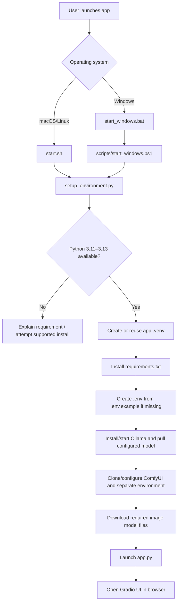
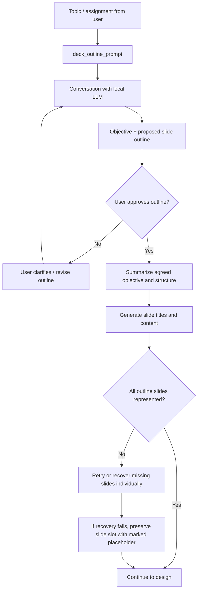
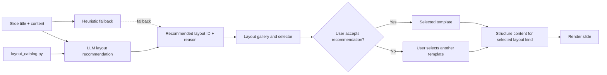
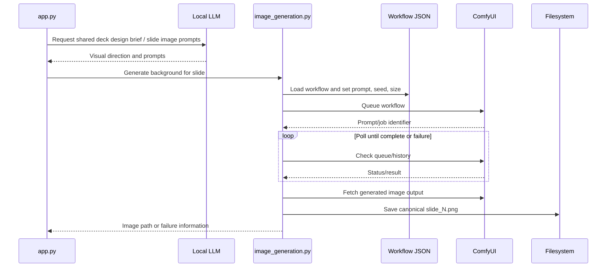
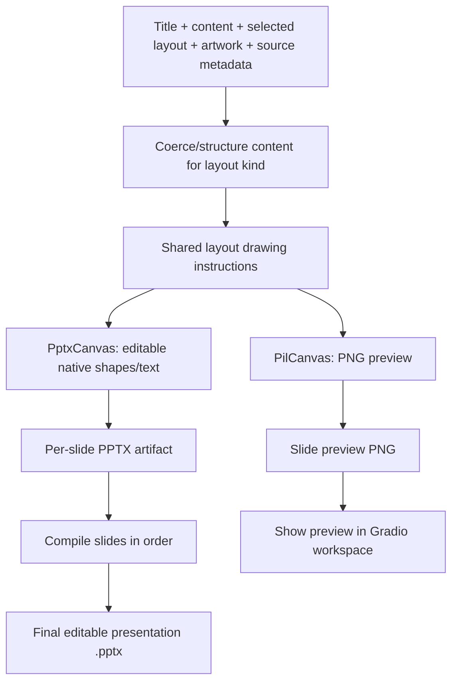
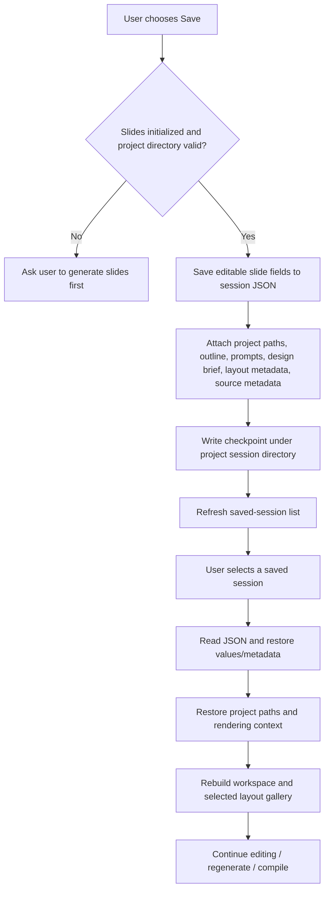
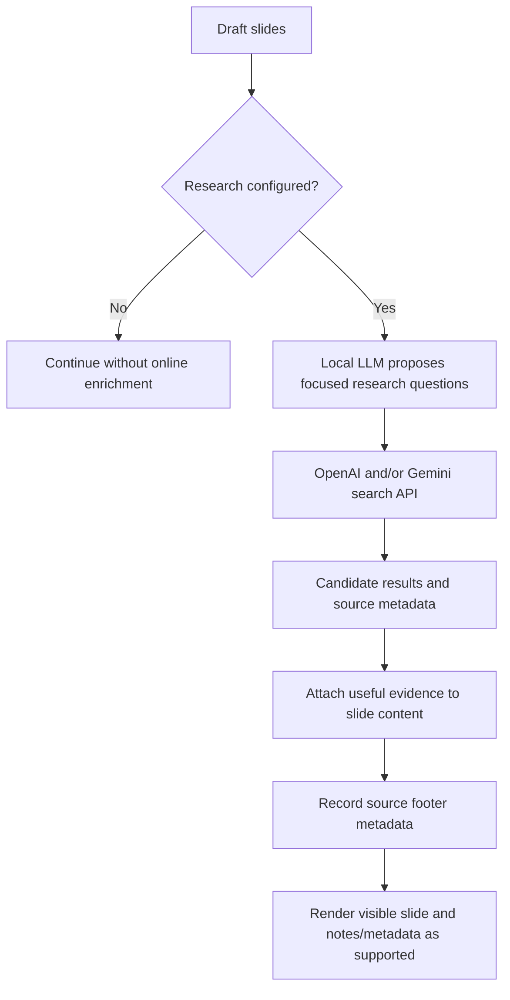

# 3. End-to-end workflows

## 3.1 First-run installation

The first run is intentionally heavyweight. The README estimates at least 35 GB of free disk space and recommends 32 GB system RAM and an NVIDIA GPU with 16 GB+ VRAM for a good experience with the default lower-memory image model. These are recommendations from the repository, not universal minimums; actual performance depends on model choices, drivers, and hardware.

Subsequent runs reuse local environments, ComfyUI checkout, and model files. The setup script is intended to be rerunnable after interrupted installation/downloads.

## 3.2 Presentation planning and content generation

The outline approval step matters because it establishes the narrative before investing in artwork and layout. The approved outline is a constraint for later stages; the system should preserve the intended slide count and order even when a model response is incomplete.

## 3.3 Layout recommendation and user override

Layout selection is deliberately separate from rendering. This makes it possible to change the visual pattern while preserving the underlying subject and editable content. A new layout normally requires coordinated metadata and drawing support: adding only a catalogue record is insufficient if the renderer does not implement its content kind.

## 3.4 Background image generation

The current default workflow targets 16:9 artwork. The image-generation module can start a managed ComfyUI process when configured to do so, reuse it for a batch, and stop it afterward to release VRAM. If ComfyUI is externally managed, the app can instead use that existing server.

The image generator and workflow must remain in sync: the Python module references workflow node IDs for prompt, seed, size, and model settings. A changed workflow export may change those IDs.

## 3.5 Slide rendering and final compilation

The preview is a convenience, not the authoritative output. The project documents historical cases where PowerPoint transparency differed from the PNG preview; shared drawing instructions and explicit PowerPoint output fixes reduce, but cannot eliminate, differences between Pillow's font rendering and PowerPoint's own text layout.

## 3.6 Save and resume

A checkpoint is more than a transcript. It needs enough metadata to restore the active project folder, slide state, deck outline, design brief, layout recommendations, structured content, selected templates, and research-source footers. Any new runtime state that influences rendering or editing should be reviewed for serialization.

## 3.7 Regenerating slide design

The repository's merge notes describe a “Regenerate Slide Design” action after slides are initialized or resumed. The intended behavior is to create a fresh shared design brief, attempt background generation for every slide, and rerender slides while preserving current titles, content, and selected layouts. If one image fails, later slides should still be attempted rather than aborting the entire batch.

This is an important separation of concerns: **regenerate visual design** should not silently rewrite the user's approved narrative. If implementation changes this behavior, update this section and add a regression test.

## 3.8 Optional research enrichment

Research is not equivalent to fact verification. The application can collect sources and show provenance, but users should still check that a cited page supports the claim, is current enough, and is authoritative for the subject.
